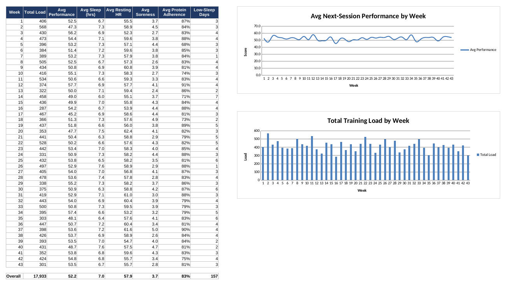

# AI Workout Performance Analyzer

A machine learning pipeline that predicts next-session workout performance
using training load, sleep, nutrition (macro adherence), and recovery
metrics (resting heart rate, soreness), trained on 300 days of synthetic
daily data.

## What it does

- Engineers features from raw daily logs: 7-day rolling averages, trend
  deltas (today vs. recent average), and macro adherence relative to a
  protein target.
- Trains and compares two models: **Ridge Regression** and
  **Random Forest Regressor**.
- Evaluates both with a held-out test set (MAE, R²) and 5-fold
  cross-validation.
- Produces diagnostic plots (predicted vs. actual, residual analysis) to
  sanity-check model behavior rather than trusting a single metric.
- Surfaces Random Forest feature importances to show which inputs actually
  drive next-session performance.

## Tech stack

Python, Pandas, NumPy, Scikit-learn, Matplotlib, Excel.

## Project structure

```
ai-workout-performance-analyzer/
├── generate_data.py              # Synthetic 300-day dataset generator
├── train_model.py                # Feature engineering, training, evaluation, plots
├── workout_data.csv              # The generated dataset
├── Workout_Data_Analysis.xlsx    # Excel analysis of the same dataset
├── plots/diagnostics.png         # Model diagnostic plots
├── requirements.txt
└── README.md
```

## Running it

```bash
pip install -r requirements.txt
python train_model.py
```

This generates a synthetic `workout_data.csv` on first run (or uses one
you supply, in the same format), trains both models, prints evaluation
metrics to the console, and saves diagnostic plots to `plots/diagnostics.png`.

## Sample output

```
--- Ridge Regression ---
Test MAE:        3.68
Test R^2:        0.632
5-fold CV MAE:   3.18 (+/- 0.33)

--- Random Forest ---
Test MAE:        4.28
Test R^2:        0.468
5-fold CV MAE:   3.82 (+/- 0.42)
```

## Excel Analysis

`Workout_Data_Analysis.xlsx` analyzes the same 300-day dataset in Excel:

- **Log:** the daily data, plus formula columns that rebuild the Python
  features (7-day average load, load trend delta, protein adherence) so the
  Pandas feature engineering can be checked against an independent version.
  It also has a low-sleep flag and conditional formatting.
- **Weekly Summary:** SUMIFS/AVERAGEIFS rollups by week, with trend charts
  for performance and training load.
- **PivotTable:** weekly breakdown of training load and performance.
- **By Day + Lookup:** averages by day of the week, plus a date lookup
  (INDEX/MATCH and XLOOKUP).



## Notes

The included dataset is synthetically generated to have realistic
correlations (e.g. poor sleep and elevated resting heart rate reduce
predicted performance) so the pipeline has real signal to learn from.
Swap in real training-log data with the same column structure to use
this on an actual dataset.
